<p align="center">
  <a href="https://codepulse-team25.netlify.app">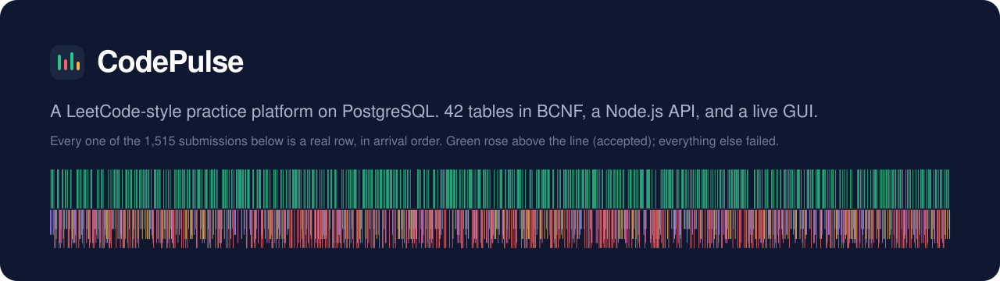</a>
</p>

<p align="center">
  <a href="https://codepulse-team25.netlify.app"></a>
</p>
<p align="center">
  
  
  
  
  
  
</p>

<p align="center">
  <b>Team 25</b> · MC212 Database Management Systems · Lab 11 (database connectivity and GUI)<br>
  Ishaan Kaneria (202503004) · Mann Chauhan (202503045)
</p>

---

**CodePulse** is a LeetCode-style practice platform whose whole state lives in PostgreSQL: problems and their hidden tests,
1,515 judged submissions with failure logs, contests with pre-calculated leaderboards, Premium subscriptions and feature gates,
company question frequencies, discussions, moderation, study plans and badges.

The web app puts each of the **12 functions in our SRS (version 6)** on its own screen, gives full **create, read, update and delete on `problems`**,
and runs all **30 queries from Lab 10A** against the live database. Every card can show the exact SQL behind it.

<picture>
  <source media="(prefers-color-scheme: dark)" srcset="docs/screenshots/overview-dark-1440.png">
  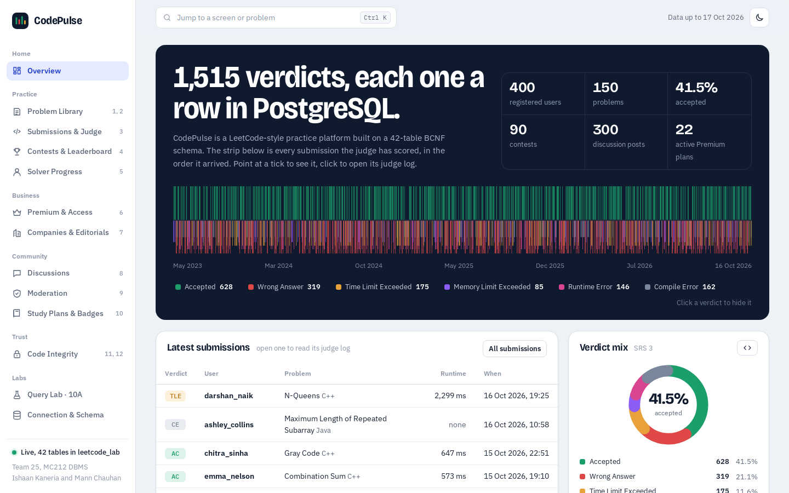
</picture>

## Highlights

- **The verdict waveform.** The Overview draws every submission in arrival order. Accepted code rises above the line, failures drop below it, and each failure type has its own colour and depth. Point at a tick to see it; click to open its judge log. Click a verdict in the legend to hide it.
- **Real CRUD, real constraints.** Create, edit and delete problems with their topic and company tags in one transaction. Deleting a problem that still has submissions, contest entries or posts is refused by a foreign key, and the app explains which one.
- **Nothing is hidden.** A *View SQL* button sits on every screen. The SQL lives on the server; the browser only sends a query name and typed values, which reach PostgreSQL as `$1, $2 …` placeholders.
- **Jump anywhere.** Press <kbd>Ctrl</kbd> <kbd>K</kbd> (or <kbd>/</kbd>) to open the command palette, then type a screen name, a problem title or a problem id.
- **Light and dark, phone and desktop.** It follows your system theme and works at 390 px wide.

## Screens

| | |
|:---:|:---:|
| 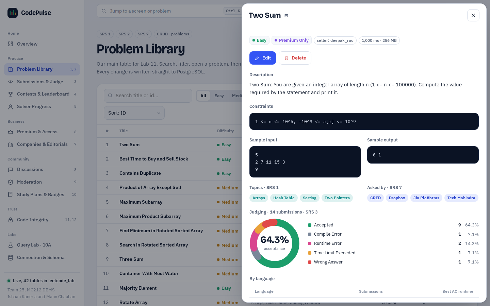<br>**Problem library** — search, filter, open, edit, delete | 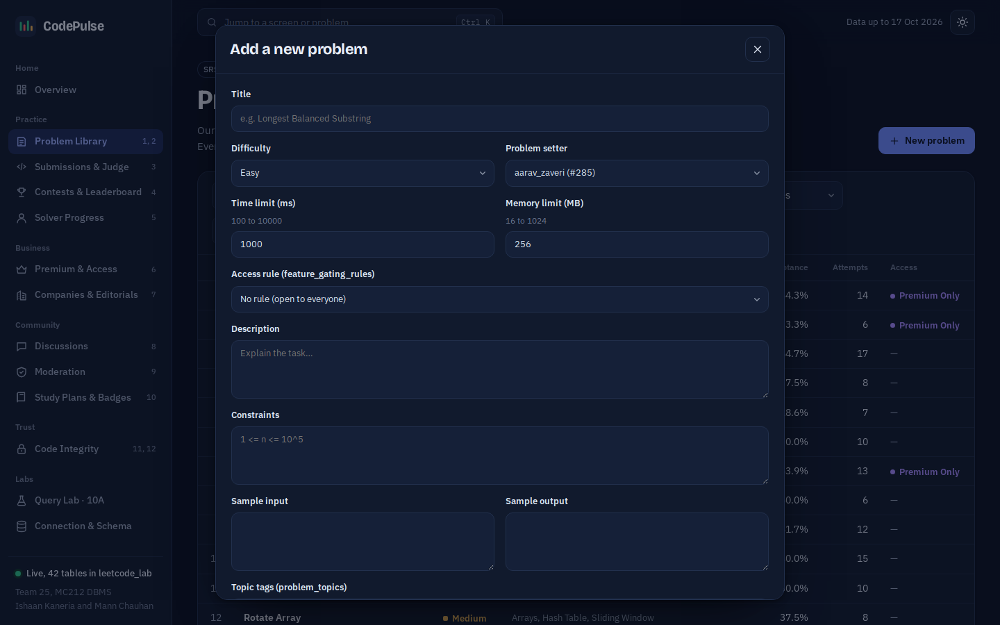<br>**New problem** — validated on the server before any SQL runs |
| 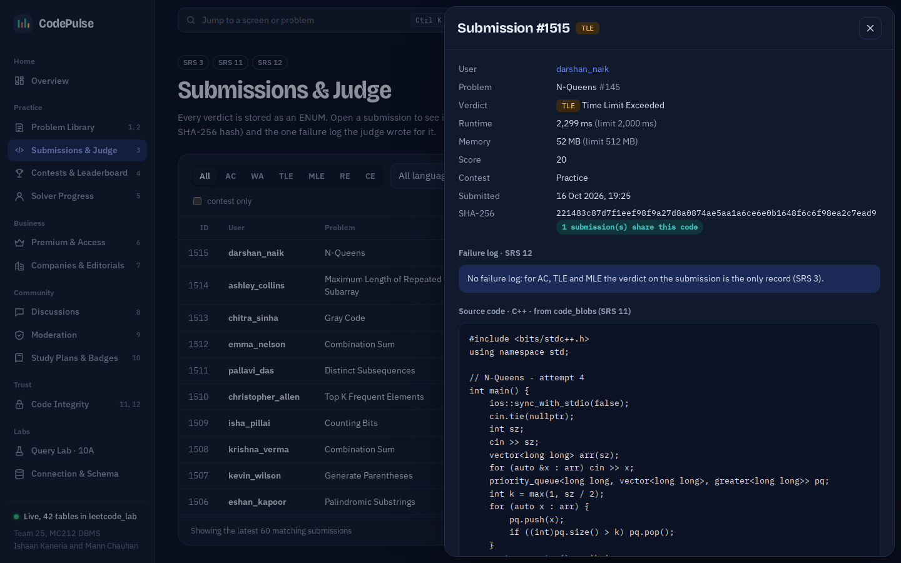<br>**Submissions & judge** — the code blob by SHA-256 and its one failure log | 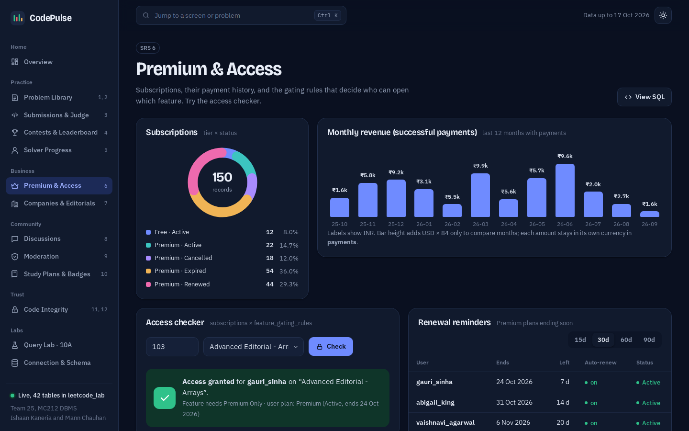<br>**Premium & access** — revenue, renewals and a live access checker |
| 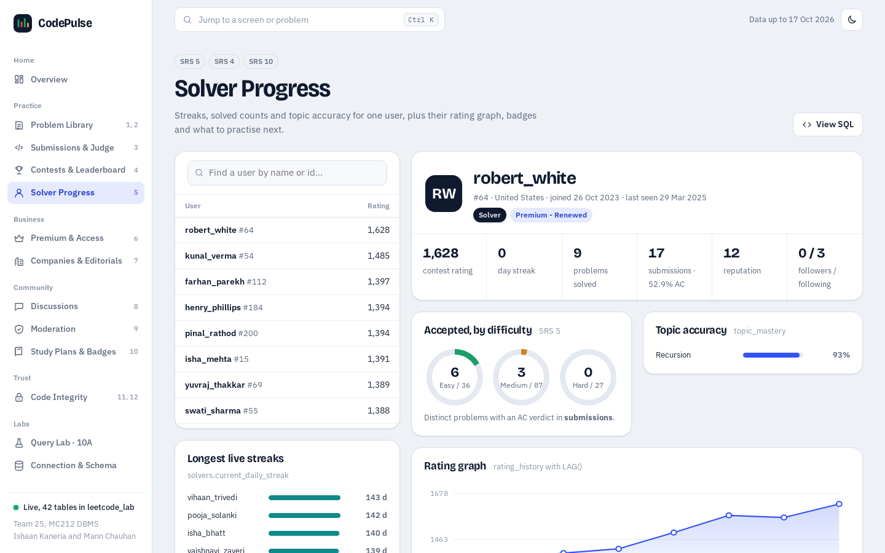<br>**Solver progress** — streaks, solved rings, rating graph with `LAG()` | 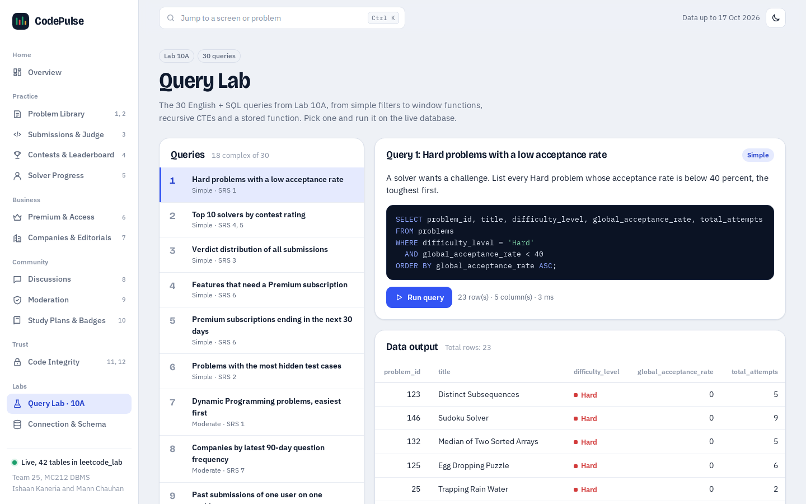<br>**Query lab** — run any of the 30 Lab 10A queries |
| 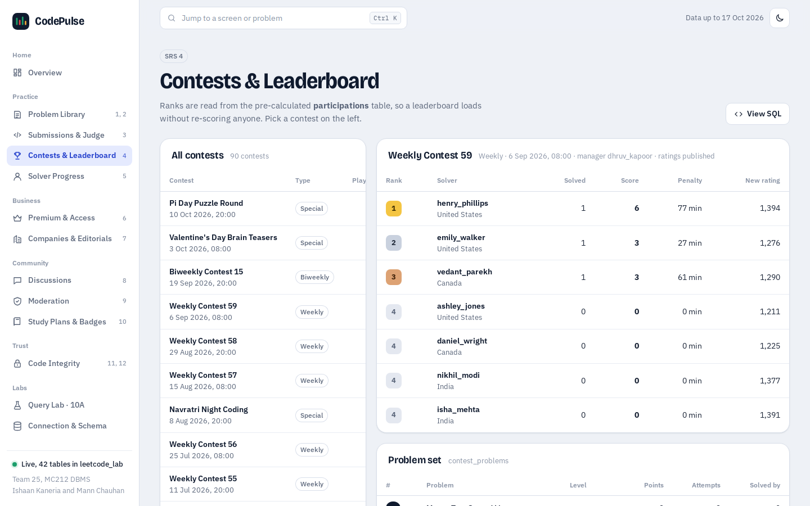<br>**Contests** — leaderboards read from pre-calculated ranks | 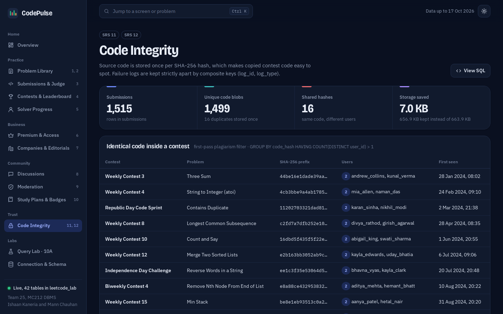<br>**Code integrity** — dedup savings and identical contest code |

<p align="center">
  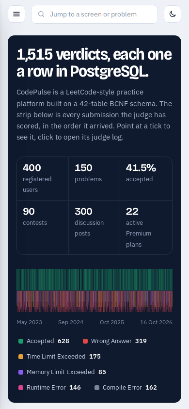
  &nbsp;&nbsp;
  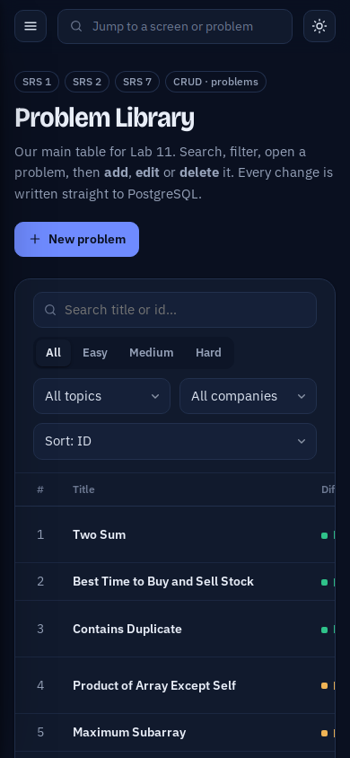
</p>

<details>
<summary><b>All 13 screens and the SRS function each one covers</b></summary>

| Screen | SRS V6 | What you can do |
|---|---|---|
| Overview | all | The verdict waveform, live totals, verdict mix, difficulty split, languages, latest submissions, a map of all 12 functions |
| Problem Library | 1, 2, 7 | **Create, read, update and delete problems**, with topic tags, company tags, test cases and per-problem judging stats |
| Submissions & Judge | 3, 11, 12 | Filter by verdict, language, user or contest; open a submission to see its code blob and its failure log |
| Contests & Leaderboard | 4 | Every contest, its pre-calculated leaderboard, its problem set, and the global rating ladder |
| Solver Progress | 5, 4, 10 | Profile, solved rings, topic accuracy, rating graph (`LAG`), badges, practice suggestions, people to follow |
| Premium & Access | 6 | Subscriptions, renewal reminders, revenue, payments, gating rules, and a live **access checker** |
| Companies & Editorials | 7 | Company frequency snapshots (30, 90 and 180-day windows), problems asked, and editorials with code snippets |
| Discussions | 8 | Posts with votes, bookmarks and comments; threaded replies; top contributors |
| Moderation | 9 | Review queue (reports with no review), reasons, moderator workload, full review history |
| Study Plans & Badges | 10 | Plans with their ordered days, learner progress, badge catalogue, and badges due |
| Code Integrity | 11, 12 | SHA-256 dedup savings, identical contest code, and a check that failure logs stay disjoint |
| Query Lab | Lab 10A | Run any of the 30 Lab 10A queries and see the output |
| Connection & Schema | Lab 11 | `SELECT version()`, the request path, and a row count for all 42 tables |

</details>

## How it fits together

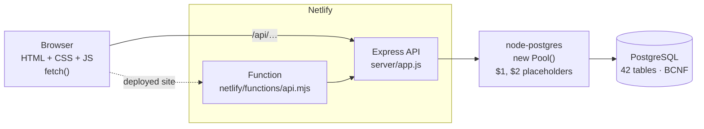

The same Express app runs in three places: on your laptop (`npm start`), in a GitHub Codespace, and on Netlify as a single serverless
function. On Netlify it reads the database address from Netlify Database (`NETLIFY_DB_URL`); locally it reads `.env`.

## The database

| | |
|---|---|
| Tables | **42**, normalised to BCNF |
| Rows | about 14,900 of sample data, up to 17 Oct 2026 |
| Integrity | 58 foreign keys, 49 `CHECK` constraints, 15 `ENUM` types |
| Extras | a trigger (`trg_reply_same_post`) that keeps a reply on the same post as its parent, and 5 indexes for the hot paths |

Some design choices the screens make visible:

- **Verdicts are an `ENUM`**, and each failing verdict writes exactly one row in one of three disjoint log tables (compiler, runtime, judge), enforced by a composite key `(log_id, log_type)`.
- **Code is stored once per SHA-256 hash** in `code_blobs`, so identical submissions share a row. That saves space and catches copied contest code.
- **Leaderboards are pre-calculated** in `participations`, so a contest page reads ranks instead of re-scoring anyone.
- **Company frequency is a series of dated snapshots** keyed by `(company_id, snapshot_date, window_days)`, never overwritten.

The schema is in [`db/01_create_tables.sql`](db/01_create_tables.sql) and the data in [`db/02_insert_data.sql`](db/02_insert_data.sql).

## Run it

### On your laptop

You need Node.js 18 or newer and PostgreSQL.

```bash
npm install
cp .env.example .env          # Windows: copy .env.example .env
# set PGDATABASE, PGUSER and PGPASSWORD in .env
npm run db:load               # creates the 42 tables and loads every row (drops the public schema first)
npm run test:conn             # prints the PostgreSQL version and "Tables in public schema: 42"
npm start                     # http://localhost:3000
```

`npm run dev` restarts the server when you edit a file.

### In GitHub Codespaces

Click **Code → Codespaces → Create codespace on main**. The Codespace starts Node 22 and PostgreSQL 16, loads both SQL files,
creates `.env` and runs `npm start`. Port 3000 opens in a preview tab.

### On Netlify

The site uses **Netlify Database**, Netlify's built-in PostgreSQL, so there is no separate database account to set up.

1. Import this repository in Netlify (**Add new site → Import an existing project**). The build settings come from `netlify.toml`.
2. Deploy. Netlify creates the database and applies the two migrations in [`netlify/database/migrations/`](netlify/database/migrations), which are our two SQL files.
3. Open the site. The rail should say **Live, 42 tables in netlifydb**.

To use another hosted PostgreSQL instead (Neon, Supabase…), set `DATABASE_URL` in the site's environment variables, load the data with
`DATABASE_URL="…" npm run db:load`, and redeploy. `DATABASE_URL` wins over `NETLIFY_DB_URL`.

## API

| Method | Path | Purpose |
|---|---|---|
| GET | `/api/health` | `SELECT version()`, database name, table count |
| GET | `/api/problems?q=&difficulty=&topic_id=&company_id=&sort=&page=&size=` | **Read** a page of problems |
| GET | `/api/problems/:id` | **Read** one problem with topics, companies, test cases, verdicts |
| POST | `/api/problems` | **Create** a problem and its tags in one transaction |
| PUT | `/api/problems/:id` | **Update** a problem (`WHERE problem_id = $11`) |
| DELETE | `/api/problems/:id` | **Delete** a problem (`WHERE problem_id = $1`); 409 with the reason if a foreign key blocks it |
| GET | `/api/problems/meta` | Setters, rules, topics and companies for the form |
| GET | `/api/q/:key?…` | A named read-only query for a screen (see `server/queries/srs.js`) |
| GET | `/api/sql/:key` | The SQL text behind a screen |
| GET | `/api/lab10a`, `/api/lab10a/:id` | List or run the 30 Lab 10A queries |

## Safety rules we follow

- **Placeholders everywhere.** Every user value is sent as `$1, $2 …`. Searching for `'; DROP TABLE problems;--` returns no rows and changes nothing.
- **No password in Git.** `.env` is in `.gitignore`. Netlify supplies the database address through its own environment.
- **A `WHERE` on every `UPDATE` and `DELETE`**, always on the primary key.
- **Validation on the server** before any SQL runs: title length, difficulty, and time and memory limits that match the `CHECK` constraints.
- **The browser never connects to PostgreSQL.** It only calls our API.
- **Sort orders come from a fixed list** on the server, never from raw input.

## Project layout

```
├── server/
│   ├── db.js                 new Pool(), run(), withTransaction()          Lab 11 A
│   ├── app.js                Express routes, health check, error handling
│   ├── index.js              starts the server locally or in a Codespace
│   ├── routes/problems.js    INSERT, SELECT, UPDATE, DELETE on problems     Lab 11 B
│   └── queries/
│       ├── srs.js            read-only queries behind every screen
│       └── lab10a.js         the 30 Lab 10A queries
├── public/                   the frontend: HTML, CSS, JavaScript             Lab 11 C
├── netlify/
│   ├── functions/api.mjs     runs the Express app as a Netlify Function
│   └── database/migrations/  the two SQL files, applied by Netlify Database
├── scripts/                  test-connection.js, load-db.js
├── db/                       01_create_tables.sql, 02_insert_data.sql
├── docs/                     banner and screenshots for this page
└── .devcontainer/            GitHub Codespaces: Node 22 + PostgreSQL 16
```

## Lab 11 submission checklist

`TeamNo_Lab11_DBConnectivity.pdf`

| Section | What to show |
|---|---|
| A. Connectivity | `server/db.js` (`new Pool()`, `run()`), `.env` with the password hidden, and the output of `npm run test:conn` |
| B. CRUD code | The `POST /`, `GET /`, `PUT /:id` and `DELETE /:id` handlers in `server/routes/problems.js`, each with its SQL and the `rowCount` toast |
| C. Frontend | The new problem form, the problem table, the edit form, the delete confirmation, and the same row in pgAdmin before and after |
| D. Reflection | 150 to 250 words on what went wrong and what you learned |
